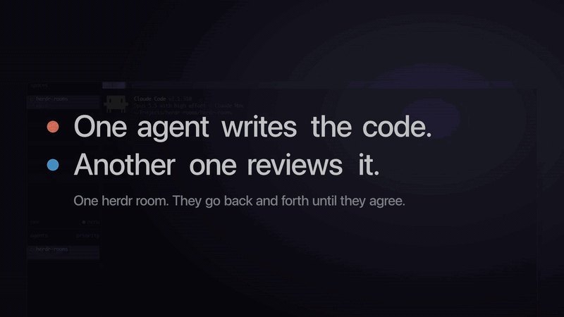
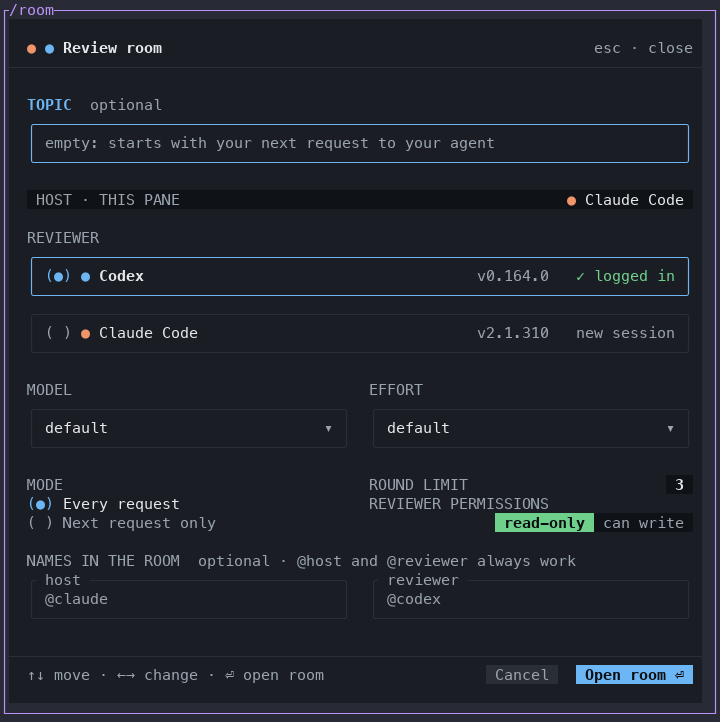
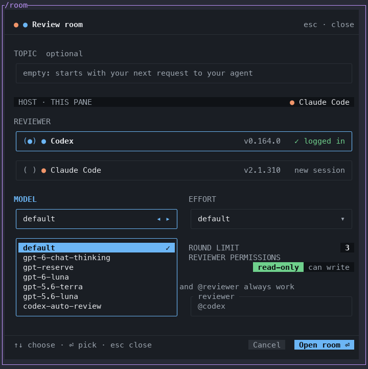
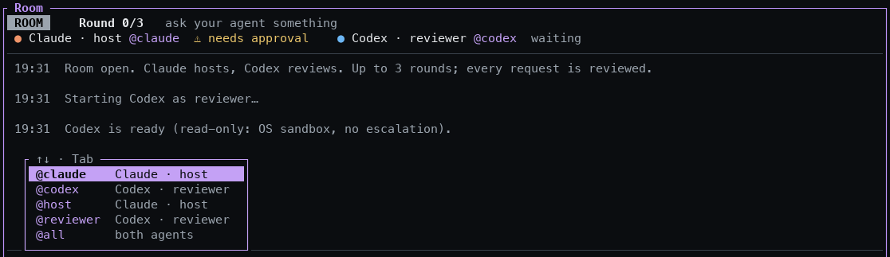

# herdr-rooms

A [herdr](https://herdr.dev) plugin for rooms where your coding agents work together. The first kind is the **review room**. From a Claude Code or Codex session, open a room and pick a reviewer agent and its model. From then on the reviewer checks every answer and code change of your session, the two argue until they agree or reach the round limit, and you watch and step in from the room. Brainstorm rooms and task runs come next (see [Roadmap](#roadmap)).

<p align="center">
  
</p>

```
┌ claude · host ─────────┬ codex · reviewer ───────┐
│ your session           │ a real, interactive     │
│                        │ agent: type in it to    │
│                        │ speak as the reviewer   │
├────────────────────────┴─────────────────────────┤
│ ROOM   Round 1/3   Codex is reviewing…           │
│ 14:05  YOU            make avg handle []         │
│ 14:05  CLAUDE · host @claude  …                  │
│ 14:05  CODEX · reviewer @codex  ✗ DISAGREES  O1… │
│ ┌ To: both (Tab, or @claude / @codex) ──────────┐│
└──────────────────────────────────────────────────┘
```

## Words

| Word | Meaning |
| --- | --- |
| room | where agents work together, shown in a pane under your session |
| host | the agent you work with, whose answers and changes are reviewed: at first the session you open the room from |
| reviewer | in a review room, the agent that reviews the host's work: at first one the room starts (`/swap` switches the two) |
| moderator | the room's own logic: it relays messages, counts rounds and reads verdicts |
| round | one review and the host's reply to it |

## Requirements

- herdr 0.9.5 or later
- Rust and cargo: herdr builds the plugin from source when it installs it
- [Claude Code](https://claude.com/claude-code), [Codex CLI](https://github.com/openai/codex), or both, logged in. Either one can host and either one can review.

| Platform | Status |
| --- | --- |
| macOS | Tested end to end. |
| Linux | Builds without warnings; not yet run end to end. A read-only Claude Code reviewer needs `bubblewrap` and `socat`, which Claude Code's sandbox runs on (`apt install bubblewrap socat`). |
| Windows | Through WSL2: install herdr, Claude Code and Codex inside WSL2 and follow the Linux line. Native Windows is not supported yet: the install script and the hooks are POSIX shell, and Claude Code's sandbox does not run there. |

## Install

```sh
herdr plugin install enes/herdr-rooms
```

That is the whole install.

herdr shows what it will run and asks you to confirm. Its build step, `scripts/install.sh`, then builds the binary with cargo and runs `herdr-rooms install`, which:

- links `herdr-rooms` and `room` into `~/.local/bin`, which must be on your `PATH`;
- adds the Claude Code plugin (`/room` and the hooks), when `claude` is on your `PATH`;
- writes `/room` to `~/.claude/commands/room.md` as well. Claude Code lists a plugin's commands under the plugin's name, as `/herdr-rooms:room`, so this keeps the short `/room` next to it. A `room.md` of your own there is left alone;
- writes the `$room` skill to `~/.codex/skills/room/`;
- adds one line to `~/.codex/config.toml`: `notify = ["…/herdr-rooms", "hook", "codex-notify"]`. This is how a Codex host's turns reach the room; outside a room the hook exits at once. Codex allows one notify program, so if you already have one, the line is not added (see [Limits](#limits-v02)).

**After installing:**

- **Updates:** `herdr plugin update herdr-rooms` builds the new version in a new folder and runs the same setup, which points the links and the Claude Code plugin at it. A Claude Code session already running takes changed hooks at its next start or with `/reload-plugins`.
- **Repair:** the palette action *Rooms: set up Claude Code and Codex again* (`herdr plugin action invoke install --plugin herdr-rooms`) runs the setup again.
- **Building without the setup:** to leave your agents' configuration alone, install with `HERDR_ROOMS_SKIP_SETUP=1` in the environment. herdr then only builds, and you can run the action above when you want the setup.

### From a local folder

For a clone, a downloaded ZIP, or your own changes:

```sh
git clone https://github.com/enes/herdr-rooms && cd herdr-rooms   # or unzip the download and cd into it
sh scripts/install.sh --link
```

`--link` does what herdr's install does by itself: after building and setting up the agents, it registers the folder with herdr (`herdr plugin link`).

- **Keep the folder where it is:** the links in `~/.local/bin` and the Claude Code plugin point into it.
- **Update:** `git pull && sh scripts/install.sh --link`. `herdr plugin update` skips linked plugins. Claude Code reads the plugin in place from `claude-plugin/`, so a running session takes changed hooks at its next start or with `/reload-plugins`.
- **Remove:** `herdr-rooms uninstall`, then `herdr plugin unlink herdr-rooms`, then delete the folder.
- **Switching to a GitHub install:** herdr does not install a plugin over a linked one, so run `herdr plugin unlink herdr-rooms` first.

## Use

Open a room from the agent you are working with, in a herdr pane:

| In | Type |
| --- | --- |
| Claude Code | `/room` (or `/herdr-rooms:room`, or `!room`) |
| Codex | `!room` (or `$room`) |

The room binds itself to the conversation that typed the command, so it opens only from inside the agent, not from herdr's command palette.

Why Codex has no `/room`: a Claude Code plugin can add a slash command that runs a program, and a Codex plugin cannot. Both agents run a shell command typed after `!`, so `!room` works in either one. `$room` asks the Codex model to run the command instead. Codex's sandbox blocks the socket herdr listens on, so Codex asks you to approve it first.

<p align="center">
  
</p>

**The popup** has these fields:

- an optional topic, a label shown in the room's header (it is not sent to your agent);
- the reviewer (Codex or Claude Code), with its model and effort;
- the round limit;
- the reviewer's permissions;
- optional names for the two agents in the room, one word each, such as `ada` and `max`.

Click a field or move with `↑`/`↓`; `←`/`→` change a value (in the names row, they move between the two boxes). `Enter`, `Space` or a click on Model or Effort opens its list; `Enter` anywhere else opens the room. The model and effort apply to the reviewer only: the host keeps the model of your session (`/model` there).

<p align="center">
  
</p>

**The room.** `Enter` sends to the recipient shown, and `Tab` cycles between both, the host and the reviewer.

- **To both:** the host's answer goes on to review, as a request typed to the host does. When no review is running, the message is the request that review is of; while one runs, it steers that review and the request stays. The reviewer's own reply is only shown in the room.
- **To one agent alone:** a side talk. Its reply is only shown in the room, the other agent sees neither the message nor the reply, and a review in progress goes on as before.
- **When a review ends,** the host is told how (the reviewer's last words, and whether it agreed or the rounds ran out); its reply, a line at most, stays in the room.
- **What goes to a Codex cannot name its skills:** a `$name` naming an installed skill, typed into Codex, is a skill mention, which loads the skill and sends the agent off to run it. Text the room relays to a Codex gets a full-width `＄` before such names only (`$room` reads `＄room`; `$HOME` and `$x:expr` in code stay), and the prompt then says so; the room's log keeps the original. The names are `room` and the folders under `~/.codex/skills`.
- **After a compaction,** the room repeats the agent's role to it (Claude Code says so through a `SessionStart` hook; a Codex's own record of the thread shows it), since the compaction may have dropped the room's messages from the agent's context.
- **After `/clear` or `/new`,** the room follows the agent to its new conversation, says so, and tells the agent its role, when the agent's report says for certain that the conversation is its own: Claude Code's `/clear` (its `SessionStart` hook names the new conversation), and a thread Codex's TUI started, reported from the pane's own process (after `/new`, `/resume` or a restart of `codex`). Every other case is left to `/rebind` (see *One session per pane* below).

- **`@` names:** an `@name` anywhere in a message sends that message to the agent it names instead. That can be:
  - a name you picked;
  - `@host` or `@reviewer`;
  - the agent's own name (`@codex`, `@claude`);
  - `@all`.
  
  A suffix such as `@codex's` is fine. When both agents are the same kind and you picked no names, `@host` and `@reviewer` tell them apart and the shared name reaches both. The status line shows each agent's `@name`, and a message that uses `@` names tells each agent which name is its own.
- **Completion:** typing `@` lists the names that start with what you typed (`@ho` → `@host`). `↑`/`↓` pick one, `Tab` or `Enter` completes it, `Esc` hides the list.
- **Typing in the reviewer's pane:** while the reviewer is idle, a private conversation with that agent: neither your message nor its reply is forwarded to the host. While it is reviewing, a message sent with Enter joins the review (Claude Code hands it to the running turn; so does Codex), and the reply goes to the host as the review; the room says so. A message Codex queues with Tab is answered in a turn of its own and stays private. To share a message at any time, send it in the room to both agents or explicitly to the host.
- **Switching roles:** type `/swap`, and the reviewer becomes the host and the host the reviewer, in the same room.
  - The switch waits until no review is running, no message waits to be sent and both agents are at their prompts. `Ctrl+E` ends a review at once; `/swap` again cancels the switch.
  - Each agent then gets one message naming its new role. Its reply only shows in the room.
  - From then on you give requests in the new host's pane or in the room. Your own pane is now the reviewer, so messages typed there between reviews stay private.
  - **In a read-only room,** the agent the room started restarts in a new pane on its own conversation (`claude --resume`, `codex resume`), so its permissions follow its role. As host it gets what a reviewer that can write gets: Codex's `workspace-write` sandbox, Claude Code with your own permissions. A resumed Codex keeps the approval policy it started with (`never` for a read-only reviewer), so as host it cannot ask to step outside its sandbox. As reviewer it gets the read-only sandbox again. Before its first turn it simply starts again. When the room does not know its session (a Codex whose notify carries no `thread-id`), it refuses the switch rather than lose that conversation.
  - **Your own session is never restarted.** As the reviewer it is asked to stay read-only, but nothing enforces it: the room can only sandbox an agent it starts.

<p align="center">
  
</p>

| To | Do |
| --- | --- |
| switch the host and the reviewer | type `/swap` |
| end the review and close the room and the agent it started (your agent's pane stays) | type `/exit` |
| pause relaying | `Ctrl+P` |
| end the review but keep the panes | `Ctrl+E` |
| close the room alone (the reviewer pane stays) | `Ctrl+Q` |
| bind an agent's other conversation to its pane when the room could not follow it on its own (a `claude` restarted in the pane, `/resume` in Claude Code, a Codex on Codex's daemon) | `/rebind <id>` (`/rebind` alone lists the candidates with what each said first; it never binds without an id, since a candidate may be a `claude -p` run from the pane); the agent is then told its role |
| send to review the host's answers that reached the room but were only logged (a background job woke it, or no prompt matched), since this room opened | `/review` (while the host is on a request, they go with its answer; while a review runs, it waits) |
| scroll the log | mouse wheel, `PgUp`/`PgDn`, `Shift+↑`/`Shift+↓`; `Home`/`End` when the input box is empty |
| move in the input box | `←`/`→`, `Alt+←`/`Alt+→` by word, `Home`/`End`, `Delete`; `Esc` clears it |

Every message the room writes to an agent asks it to reply in the language you write in, so a room you run in Turkish, say, stays in Turkish. The reviewer's `VERDICT:` line stays in English, as the room reads it.

## Reviewer permissions

### Read-only (the default)

Read-only is enforced by an OS sandbox, not only asked for. Each reviewer also gets a standing instruction at startup, so it does not try to write in the first place.

| | Codex reviewer | Claude Code reviewer |
| --- | --- | --- |
| Shell commands | Codex `read-only` sandbox (`-s read-only`) | Claude Code sandbox, with the repository root in `sandbox.filesystem.denyWrite` |
| What the OS blocks | every write, `$TMPDIR` included | writes to the repository; `$TMPDIR` stays writable for scratch work |
| Way out of the sandbox | none: `-a never`, so it cannot ask you to approve an escalation | none: `allowUnsandboxedCommands: false`, so `dangerouslyDisableSandbox` is ignored |
| Sandbox cannot start | — | `failIfUnavailable: true`: Claude exits instead of running unsandboxed |
| File-editing tools | none besides the (sandboxed) shell | `Edit`, `Write`, `NotebookEdit` disallowed |
| MCP servers | yours, from `~/.codex/config.toml` | none (`--strict-mcp-config`) |
| Standing instruction | `-c developer_instructions=…` | `--append-system-prompt-file` |

Checked on macOS: asked to run `touch probe.txt` in the repository, both reviewers got `Operation not permitted`.

What read-only does **not** cover:

- **The CLI process itself.** The sandbox wraps the reviewer's shell commands, not Claude Code or Codex. Claude Code leaves an empty `.claude/.cc-writes` folder (its own staging folder) in the repository. Hooks, this plugin's included, run outside the sandbox.
- **MCP servers in your Codex config** run outside Codex's sandbox.
- **Checks that must write inside the repository fail:** `cargo build` / `cargo test` (`target/`), most builds, test runners that keep caches in the tree. A Claude reviewer can point them at `$TMPDIR` (for example `CARGO_TARGET_DIR=$TMPDIR/target`); a Codex reviewer cannot write anywhere, so it runs checks inline.
- **Some compound shell commands** (heredocs, quoted text, several operations in one line) still go through Claude Code's own permission check and can wait for your approval in the reviewer pane, even though they would run sandboxed. The room shows ⚠ needs approval.
- **Platforms without sandbox support.** Claude Code's sandbox needs its dependencies (on Linux, bubblewrap and socat); without them a read-only Claude reviewer exits at startup rather than run unprotected.
- **The host.** It runs with your normal settings.
- **Your own session as the reviewer,** after `/swap`. It keeps the permissions it has; the room only asks it to stay read-only.

### Can write

Codex runs in its `workspace-write` sandbox and Claude Code with your normal permissions; neither gets the standing instruction. The reviewer and the host share one working tree, so they can overwrite each other's edits. The first review message therefore tells the reviewer to list every change it makes.

## How it works

One Rust binary plays every part:

1. `herdr-rooms open` shows the popup over your pane.
2. The popup writes the room's settings and opens the room under your pane.
3. The room starts the reviewer as a real agent in a split beside yours.
4. Each agent's hooks append its turns to the room's `events.jsonl`. The room tails that file, and its moderator decides what goes to whom: your agent's answer to the reviewer, the reviewer's objections back, until a `VERDICT: AGREE` or the round limit.
5. Prompts are typed into the agents through herdr's agent API.

## Roadmap

- **Brainstorm rooms:** agents discuss an open question with each other and with you, and the room collects the ideas.
- **Runs:** enter a list of tasks, pick the agents, and run it. Tasks go out one by one or in parallel, each one optionally followed by a review.

## Limits (v0.2)

- **One notify program.** Codex as the host needs the `notify` line that the install step adds, and Codex allows only one notify program. Codex's notify also reports its internal turns (a new thread's title, the catch-up for a returning user), each in a thread of its own; the hook drops them. It lists every user message of the thread so far: the hook keeps a count per thread, so a turn that ended without a notify (an error) hands its prompt to the next, and a message sent mid-turn is reported with the turn it joined.
- **Codex's shared daemon.** A Codex session can run on Codex's shared app-server daemon; its session log then says `"source":"vscode"`. Plain `codex` attaches to that daemon when one is running.
  - Its `!` commands and notify then run in the daemon, without the pane's `HERDR_*` variables.
  - herdr-rooms finds the pane anyway by asking each running herdr server for the Codex agent in that folder: the focused one for `!room`; for notify, the original Codex pane recorded in the room's configuration, even after roles switch, and only the thread the room was bound to. Old reviewer panes are excluded even when their maps predate the `started` field. If multiple original Codex sessions still match, the hook sends nothing rather than send a private conversation to the wrong room.
- **One session per pane.** `open` prints a token, which the agent that ran it keeps in its own record of the conversation (a Codex rollout, a Claude Code transcript); the popup finds the one record that holds it as a command's output and binds the room to that session, so a room has to be opened from inside the agent (`/room`, `!room`), not from the palette. The agents the room starts are bound as they start (a Claude Code session id) or at their first turn of their own (a Codex thread the TUI started, by Codex's record of it: a subagent's thread or a `codex exec` run from the pane never binds it). A hook takes no other session's report for a pane: a `claude -p` or `codex exec` run from the pane, or a Codex subagent. The agent's own new conversation takes the pane over when its report says so for certain: Claude Code's `/clear` names the conversation it starts in a `SessionStart` hook (a `claude -p` starts as `startup` or `resume`), and a thread Codex's TUI started (`source: cli` in its record), reported from the pane's own process, is the pane agent's after `/new`, `/resume` or a restart of `codex`. Any other conversation of the user's own is shown once, with the first thing it said, so you can tell the agent's new conversation from a probe: a `claude` restarted in the pane, `/resume` inside Claude Code (a `claude -p --resume` reports the same), a thread whose Codex record does not say what started it (an older Codex), and a new thread of a Codex host on Codex's daemon, whose report does not say which Codex in the room's folder sent it (noted once it reports from that folder). A Codex subagent or `codex exec` thread is known from its record and not shown. `/rebind <id>` makes a shown session the pane's and tells the agent its role (`/rebind` alone only lists them). `hook.log` in the state folder (`~/.local/state/herdr/plugins/herdr-rooms/`) says why a report for a room's pane was dropped (another session's or a subagent's, empty text, daemon routing and ambiguous matches, unreadable input, swept maps); a report from a pane no room maps leaves no trace, so sessions outside rooms cost nothing.
  - Two such Codex hosts in one folder are told apart by the thread each room was bound to.
  - Reviewers the room starts (with `-c` flags) ran in their own process in every test.
- **`$room` needs an approval.** In Codex, `$room` needs the sandbox lifted to reach herdr's socket; `!room` does not.
- **Repeated reviewer turns.** A Claude reviewer reports each turn twice when this plugin is installed in Claude Code: its hooks plus the room's own. Both copies name the same turn (Claude Code's `prompt_id`; Codex's `turn-id`), and the room keeps one. A report that names no turn is dropped when it repeats one from the same agent within 15 seconds, so two identical messages that close together count once.
- **Which prompt an answer answers.** An agent's answer is tied to its prompt by that turn id alone: a reply that comes late, after a later request has started, is logged but not counted, and the room says so; so is an answer that names a turn the room saw no prompt for, or no turn at all (those `/review` can still send to review). The order in which reports arrive is never taken as evidence of what an answer replies to, so an agent whose hooks report no turn id (Claude Code before `prompt_id`, Codex before `turn-id`) has its answers logged only. An answer that leaves background work running keeps its prompt open until the work reports back.
- **A turn nobody reported.** When an agent's pane goes from working to idle and no hook report arrives within 20 seconds, the room says so, with the error Codex's own record gives when there is one (a usage limit, say), and nothing waits on that turn any more; `Ctrl+E` likewise frees both agents. Pane maps a crashed room or a quit herdr left behind are swept when a room opens, and are kept per herdr server, since pane ids repeat across servers; maps an older build wrote keep working, and move into the server folders at the next room start.
- **Background work.** A Claude host that stops while background subagents or workflows run is reviewed once they are done, and a Claude reviewer's verdict is read once its own are done. Until then the room holds the messages it would type into that agent. Background shells and monitors do not hold the review, since a dev server or a watcher may never end; an answer such a job wakes the host for, with no review waiting on it, is logged only, and `/review` sends it to review. A Codex host's background work is not tracked: Codex's notify carries no such list.
- **No ledger of its own.** Objections are numbered by the reviewer (O1, O2, …); the room keeps no ledger of its own, and a deadlock reaches you as a room message, not a popup.

## Uninstall

```sh
herdr-rooms uninstall              # the links, the Claude Code plugin and /room, the Codex skill and notify line
herdr plugin uninstall herdr-rooms
```

Run `herdr-rooms uninstall` first: `herdr plugin uninstall` only unregisters the plugin and keeps its files. `herdr-rooms uninstall` removes only what the setup made: links in `~/.local/bin` that point at a `herdr-rooms` binary, the Claude Code plugin and its marketplace, the `/room` command and the skill it wrote, and the notify line that calls `codex-notify`. The rooms' logs stay in `~/.local/state/herdr/plugins/herdr-rooms`.

## License

MIT, see [LICENSE](LICENSE). The Rust dependencies are all under permissive licenses: MIT or Apache-2.0 for nearly all of them, plus Zlib, BSL-1.0, Unlicense and Unicode-3.0 terms for a few. None is copyleft.

herdr-rooms is not affiliated with Anthropic, OpenAI or herdr. It runs the Claude Code and Codex CLIs installed on your machine, under their own terms.
